# Anthropic Art

Generate authentic, hand-drawn editorial SVG illustrations in Anthropic's signature visual language for Claude Code.

---

## 4-Panel Animated Showcase

| Constitutional Alignment | Extended Thinking |
|:---:|:---:|
|  |  |
| **Autonomous Tool Execution** | **Computer Use & Desktop Agents** |
|  |  |

---

## How It Works

The skill directly outputs clean, hand-crafted `.svg` files based on Anthropic's **3-layer visual grammar**:

1. **Full-Bleed Opaque Field**: 100% canvas coverage using Anthropic's verified palette tokens (`clay #D97757`, `heather #CBCADB`, `cactus #BCD1CA`, `sky #6A9BCC`, etc.).
2. **Irregular Ivory Carrier (`#FAF9F5`)**: An organic paper cutout or artifact body providing contrast between the background and ink.
3. **Bold Charcoal Linework (`#141413`)**: Gestural dip-pen line art with rounded ends and natural analog tremor.

Supports static illustrations and looping web-native animations (boiling line jitter, node pulses, gliding cursors).

---

## Installation

### 1. Global / User Scope (Recommended)
Available everywhere across all projects and terminal sessions.

**macOS / Linux / WSL:**
```bash
git clone https://github.com/AbdoKnbGit/Anthropic-Hand-Drawn-Illustrations-SKILL.git ~/.claude/skills/anthropic-art
```

**Windows (PowerShell / Scoop):**
```powershell
git clone https://github.com/AbdoKnbGit/Anthropic-Hand-Drawn-Illustrations-SKILL.git "$HOME\.claude\skills\anthropic-art"
```

*(Works out-of-the-box across all operating systems. Claude Code automatically scans `~/.claude/skills/` on launch).*

---

### 2. Project Scope (Per-Project)
Available strictly inside a specific project (committed with your project code so teammates get it too).

Navigate to the root directory of **any project** where you want the skill, and run this single command:

**macOS / Linux / WSL / Git Bash:**
```bash
git clone https://github.com/AbdoKnbGit/Anthropic-Hand-Drawn-Illustrations-SKILL.git .claude/skills/anthropic-art
```

**Windows (PowerShell):**
```powershell
git clone https://github.com/AbdoKnbGit/Anthropic-Hand-Drawn-Illustrations-SKILL.git .claude\skills\anthropic-art
```

*(Git automatically creates the `.claude/skills/anthropic-art/` directory tree and places the skill files inside. When you launch Claude Code in that project, the `/anthropic-art` skill is detected and loaded immediately).*

---

## Usage

In any Claude Code session, invoke the skill with `/anthropic-art` or plain English:

```text
/anthropic-art Create a 16:9 hero card on clay background (#D97757) for "Constitutional AI".
```

```text
/anthropic-art Create a square editorial card on heather background (#CBCADB) for "Extended Thinking & Reasoning".
```

To animate any generated illustration:
```text
Make it animated with a subtle boiling line and pulsing node loop.
```

---

## Verified Color Palette

| Token | Hex | Mood & Subject |
|---|:---:|---|
| **clay** | `#D97757` | Major launches, breakthroughs, energy |
| **heather** | `#CBCADB` | Research, foundational reasoning, reflection |
| **cactus** | `#BCD1CA` | Safety frameworks, governance, systems |
| **sky** | `#6A9BCC` | Developer platform, infrastructure, connectivity |
| **oat** | `#E3DACC` | Human collaboration, operational docs |
| **olive** | `#788C5D` | Long-term stewardship, durability |
| **fig** | `#C46686` | Creativity, writing, cultural nuance |
| **coral** | `#EBCECE` | Community, accessibility, care |

---

## License

MIT License.
